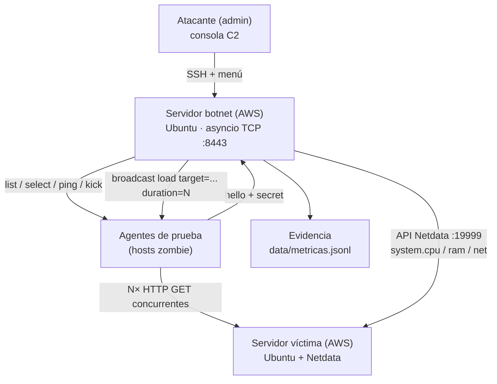

# Laboratorio Botnet C2 — Administración Remota, Inundación Controlada y Métricas del Objetivo.

**Integrantes**:
- Luis Alejandro López Reyes
- Sámiel Marín Cambronero

Prototipo de **servidor de comando y control (C2) + botnet de laboratorio**: recibe
conexiones inversas concurrentes de agentes de prueba, las administra mediante un
menú de consola, ordena una inundación de solicitudes acotada contra un servidor
víctima y registra las métricas del objetivo vía la API de Netdata (antes, durante
y después de cada prueba).

> **Ámbito autorizado del curso.** Laboratorio de Seguridad de TI II (UTN) con
> autorización del docente: se ejecuta únicamente sobre instancias propias en AWS
> y equipos de prueba del laboratorio. El servidor C2 se despliega como servicio
> persistente en la instancia del equipo (arranque automático y reinicio ante
> fallos, sin ventanas, administrado por SSH y consola) y todo el código usa solo
> la biblioteca estándar de Python. La inundación es acotada, con objetivo
> explícito (`duration` ≤ 120 s, `concurrency` ≤ 200 por agente, solo `http://`),
> y no debe utilizarse fuera del alcance autorizado del curso.

**Estado:** implementado y validado en local (57 pruebas unitarias + prueba de humo
+ prueba en vivo con agente real, inundación y métricas). Incluye servicio
persistente para la instancia (`server/deploy/`). Pendiente: despliegue en AWS y
ensayo final con el `.exe` del compañero.

## 1. Datos del curso

| Campo | Detalle |
|---|---|
| Institución | Universidad Técnica Nacional (Ingeniería en TI) |
| Curso | Seguridad de TI II (Investigación) |
| Docente | M.Sc. Roberto Escobar Agüero |
| Exposición | 11/11/2026 |
| Valor | 40 pts (20 %); el servidor botnet aporta 20 pts |

## 2. Diagrama de flujo del sistema



Flujo completo: cada zombie abre una conexión inversa y se registra; el atacante
la administra desde la consola (listar, seleccionar, ping, expulsar); al ordenar
`load`, cada zombie genera solicitudes HTTP concurrentes contra el servidor víctima
(el estrés se ve en el dashboard de Netdata); el C2 consulta la API de Netdata y
deja un registro JSONL de CPU, RAM y red antes/durante/después, listo para el informe.

## 3. Qué incluye

| Archivo | Función |
|---|---|
| `server/main.py` | Punto de entrada: carga `.env`, inicia el servidor TCP y la consola |
| `server/c2/config.py` | Configuración por `.env` / variables de entorno |
| `server/c2/protocol.py` | Protocolo: un mensaje JSON por línea, máximo 64 KB |
| `server/c2/agent.py` | Conexión de un agente: envío, correlación de respuestas por `id`, timeouts y cierre |
| `server/c2/manager.py` | Servidor asyncio: registro de conexiones, eventos en vivo y broadcast |
| `server/c2/console.py` | Menú de consola + flujo `load` con métricas antes/durante/después |
| `server/c2/metrics.py` | API de Netdata: consulta y cálculo de CPU, RAM y red del objetivo |
| `server/tests/` | Suite unitaria (`run_all.py`), prueba de humo de integración y 6 módulos de pruebas |
| `agent/test_agent.py` | Agente de prueba (zombie simulado) que implementa el protocolo, el comando `load` y la reconexión automática (`--reconnect`) |
| `server/deploy/botnet-c2.service` | Unidad systemd + tmux: servidor persistente (arranque automático, reinicio ante fallos, sin ventanas) |
| `docs/protocolo.md` | Contrato de mensajes C2 ↔ agente (para integrar el `.exe` del compañero) |
| `docs/arquitectura.md` | Componentes, flujos, puertos y especificaciones de AWS |
| `docs/despliegue-aws.md` | Guía paso a paso: instancias, IPs elásticas, grupos de seguridad, Netdata |

En tiempo de ejecución se generan `logs/c2.log` y `data/metricas.jsonl`
(ambos excluidos de git en `.gitignore`).

## 4. Estructura del repositorio

```text
botnet/
├── README.md                # Este documento
├── .env.example             # Plantilla de configuración (copiar a .env)
├── .gitattributes           # Fuerza terminaciones LF en botnet-c2.service
├── .gitignore               # Excluye .env, logs/, data/, __pycache__, etc.
├── Botnet.txt               # Enunciado original de la práctica
├── docs/
│   ├── arquitectura.md      # Componentes, flujos, puertos y especificaciones
│   ├── protocolo.md         # Contrato de mensajes C2 <-> agente
│   └── despliegue-aws.md    # Guía paso a paso de AWS
├── server/
│   ├── main.py              # Punto de entrada del servidor C2
│   ├── requirements.txt     # Sin dependencias externas (solo stdlib)
│   ├── c2/
│   │   ├── __init__.py
│   │   ├── config.py        # .env y variables de entorno
│   │   ├── protocol.py      # Mensajes JSON por línea
│   │   ├── agent.py         # Conexión de un agente + solicitudes con timeout
│   │   ├── manager.py       # Servidor asyncio: registro, eventos, broadcast
│   │   ├── console.py       # Menú de consola + inundación + métricas
│   │   └── metrics.py       # API de Netdata: cpu, ram, red
│   ├── deploy/
│   │   └── botnet-c2.service  # Servicio systemd: persistente, sin ventanas
│   └── tests/
│       ├── run_all.py       # Ejecuta la suite unitaria completa
│       ├── smoke_test.py    # Integración: 2 agentes simulados, ping, broadcast, desconexión
│       ├── test_protocol.py
│       ├── test_agent_connection.py
│       ├── test_manager.py
│       ├── test_console_helpers.py
│       ├── test_metrics.py
│       └── test_load_helpers.py
└── agent/
    └── test_agent.py        # Agente de prueba (zombie simulado, solo laboratorio)
```

## 5. Requisitos y puesta en marcha local

- Python 3.11 o superior (probado con 3.13 en Windows y Ubuntu).
- Sin dependencias externas: todo usa la biblioteca estándar.
- Cuenta AWS con permiso de EC2 para el despliegue real (guía en `docs/despliegue-aws.md`).

```powershell
git clone <URL-del-repositorio>
cd botnet
Copy-Item .env.example .env        # completar NETDATA_URL (y C2_SHARED_SECRET si se usará)
python server/main.py              # escucha en 0.0.0.0:8443
```

En Ubuntu usar `python3` y `cp`:

```bash
cp .env.example .env
python3 server/main.py
```

## 6. Pruebas y calidad del código

Suite unitaria (57 pruebas, sin dependencias, sin red real):

```bash
python server/tests/run_all.py
```

Resultado esperado:

```text
Ran 57 tests in 0.13s

OK
```

Prueba de humo de integración (levanta el servidor en un puerto libre, conecta
dos agentes simulados, verifica ping, broadcast y desconexión):

```bash
python server/tests/smoke_test.py
```

Debe finalizar con `OK: smoke test del C2 paso (...)`.

| Módulo de pruebas | Qué cubre | Pruebas |
|---|---|---|
| `test_protocol.py` | Codificación/decodificación JSON por línea, tipos inválidos, EOF y límite de tamaño | 9 |
| `test_agent_connection.py` | Envío, correlación `id`↔respuesta, timeout, `fail_pending`, cierre y `touch` | 7 |
| `test_manager.py` | Orden por conexión y búsqueda por índice, id exacto, prefijo único y ambigüedad | 7 |
| `test_console_helpers.py` | Formato de tabla/tiempos, parseo de comandos y timeout dinámico de `load` | 15 |
| `test_metrics.py` | Parseo de charts de Netdata y cálculo de CPU/RAM/red sin red real | 8 |
| `test_load_helpers.py` | Parseo del objetivo HTTP, petición, topes y política de reconexión | 11 |

La prueba en vivo (manual, se muestra en la sección 9) valida el sistema completo:
agente real conectado, inundación con métricas por zombie y agregadas, y cierre limpio.

## 7. Uso: comandos de la consola

| Comando | Efecto |
|---|---|
| `list` | Tabla de agentes: #, id, equipo, usuario, SO, dirección, conectado e idle |
| `select <#\|id>` | Selecciona un agente (acepta índice, id exacto o prefijo único) |
| `send <cmd> [k=v ...]` | Envía un comando al agente seleccionado |
| `broadcast <cmd> [k=v ...]` | Envía un comando a todos los agentes |
| `ping <#\|id\|all>` | Prueba de vida (comando `ping`) |
| `kick <#\|id>` | Cierra la conexión de un agente |
| `metrics [etiqueta]` | Consulta Netdata del objetivo y registra en `data/metricas.jsonl` |
| `status` | Uptime, agentes y conexiones totales |
| `clear` / `exit` | Limpia pantalla / apaga el servidor |

Ejemplo de inundación controlada:

```text
c2> broadcast load target=http://IP_VICTIMA duration=30 concurrency=20
```

## 8. Demostración A — panel de conexiones (zombies llegando)

Terminal 1 (servidor):

```bash
python server/main.py
```

Terminales 2 y 3 (agentes de prueba; `--reconnect 5` reintenta solo si el C2 se reinicia):

```bash
python agent/test_agent.py --id zombie-01 --reconnect 5
python agent/test_agent.py --id zombie-02 --reconnect 5
```

Qué observar:

1. Cada conexión aparece en vivo: `[+] agente conectado: zombie-01 host=... user=... desde ...`.
2. `list` muestra la tabla con todas las conexiones activas y su tiempo idle.
3. `ping all` reporta latencia de cada zombie (`zombie-01 [ok]: {"pong": true}`).
4. `select 0` + `send info` devuelve datos del equipo del zombie.
5. `kick 1` expulsa a un agente y se ve `[-] agente desconectado: zombie-02`.
6. Al cerrar un agente por su lado, el evento de desconexión aparece solo.

## 9. Demostración B — inundación controlada + métricas del objetivo

Con agentes conectados y el servidor víctima activo, desde la consola:

```text
c2> metrics antes
[metricas:antes] cpu 13.9% | ram 56.0% | red 3469.0 kbit/s | guardado en data/metricas.jsonl
c2> broadcast load target=http://IP_VICTIMA duration=10 concurrency=10
inundacion en curso: 1 agente(s) -> http://IP_VICTIMA durante ~10s (10 conexiones por agente)
[metricas:durante] cpu 13.9% | ram 56.0% | red 3469.0 kbit/s | guardado en data/metricas.jsonl
zombie-01 [ok]: {"sent": 11185, "errors": 0, "duration_s": 10, "rps": 1118.5}
-> 1/1 ok | solicitudes enviadas: 11185 | errores: 0 | rps agregado: 1118
[metricas:despues] cpu 13.9% | ram 56.0% | red 3469.0 kbit/s | guardado en data/metricas.jsonl
```

(Valores de ejemplo reales de la validación local; con el servidor víctima en AWS
y varios zombies, las métricas de Netdata muestran el incremento de CPU/RAM/red
durante la carga.)

Qué observar:

1. El C2 registra automáticamente métricas **antes**, cada 5 s **durante** y
   **después** de la inundación (comando `metrics` para tomas manuales).
2. Cada zombie reporta solicitudes enviadas, errores y RPS; la consola agrega el total.
3. En el dashboard de Netdata del servidor víctima (túnel SSH a `localhost:19999`)
   se observa el estrés en vivo: CPU, RAM y tráfico de red.
4. La evidencia queda en `data/metricas.jsonl`, una línea JSON por toma:

```json
{"ts": "2026-11-11T15:30:02-06:00", "label": "antes", "cpu_pct": 4.2, "ram_pct": 18.1, "net_kbit_s": 2104.0}
```

Para practicar sin el servidor víctima basta cualquier HTTP local:
`python -m http.server 8080` y `target=http://127.0.0.1:8080`.

## 10. Cómo funciona por dentro

1. `asyncio.start_server` acepta conexiones; cada agente envía `hello` con su
   identidad y el `secret` opcional. Las reconexiones con el mismo `id` reemplazan
   la conexión anterior sin duplicar el panel.
2. Cada solicitud usa un `id` de correlación y un `future`; la respuesta del agente
   resuelve el `future`. El timeout es 10 s, y para `load` se calcula
   `duration + 20 s` para esperar la prueba completa.
3. Los eventos (altas/bajas/reconexiones) se imprimen en vivo desde `manager.py`
   hacia la consola, que lee `stdin` en un hilo daemon (cierre limpio con EOF o Ctrl+C).
4. La inundación lanza K workers asyncio por agente con fecha límite; cada worker
   abre conexión, envía `GET` con `Connection: close`, lee la respuesta y cierra.
   El agente devuelve `{sent, errors, rps, duration_s}` — sin firma ni reconocimiento
   de nada: es una carga HTTP genérica contra el objetivo indicado.
5. Métricas: se consultan tres charts de la API v1 de Netdata —
   `system.cpu` (100 − idle), `system.ram` (used / total) y `system.net`
   (suma de dimensiones) — con timeout y tolerancia a fallos por chart.
6. El apagado cierra primero los agentes y luego espera `wait_closed()` con un
   timeout de 3 s (evita el bloqueo de `Server.wait_closed()` de Python 3.12+
   cuando hay conexiones activas). Ese caso se encontró durante las pruebas en vivo
   y quedó cubierto por el flujo del smoke test.
7. Persistencia: `server/deploy/botnet-c2.service` arranca el C2 dentro de una
   sesión `tmux` gestionada por systemd (arranque al encender la instancia y
   reinicio ante fallos); la consola se administra con `tmux attach -t botnet-c2`.
   Los agentes con `--reconnect` vuelven solos si el C2 se reinicia.

El detalle del protocolo está en [`docs/protocolo.md`](docs/protocolo.md); el
compañero debe implementar `hello`, `heartbeat` y `result` con ese contrato para
conectar el `.exe` al C2.

## 11. Relación con la rúbrica (ítem 1 — 20 pts)

| Requisito del enunciado | Evidencia en el laboratorio |
|---|---|
| Menú de consola para administrar conexiones activas | `list` (tabla completa), `select`, `ping`, `kick`, `status` y eventos de altas/bajas en vivo |
| Ordenar a los hosts zombie la inundación de solicitudes | `broadcast load target=... duration=... concurrency=...` con reporte por zombie y agregado |
| Registrar las métricas obtenidas en el objetivo | Comando `metrics` + tomas automáticas antes/durante/después vía API de Netdata → `data/metricas.jsonl` |
| Conexiones concurrentes | Servidor asyncio con N agentes simultáneos, correlación por `id`, timeouts y tolerancia a desconexiones |

## 12. Mapeo MITRE ATT&CK

El laboratorio reproduce, de forma confinada, la infraestructura de un botnet y su
operación:

| Técnica ATT&CK | ID | Componente del laboratorio | Cómo se emula |
|---|---|---|---|
| Acquire Infrastructure: Botnet | T1583.005 | `server/c2/` + `agent/test_agent.py` | Se despliega la infraestructura de un botnet de laboratorio (servidor C2 + hosts gestionados) para ejercitar su administración remota. |
| Non-Application Layer Protocol | T1095 | `protocol.py`, `manager.py` | Canal de mando con protocolo propio JSON-delimitado sobre TCP crudo (no HTTP/HTTPS estándar). |
| Network Denial of Service | T1498 | Comando `load` | Inundación HTTP directa, acotada y autorizada contra el servidor víctima del laboratorio. |
| Command and Scripting Interpreter: Python | T1059.006 | `agent/test_agent.py` | El agente se ejecuta como script de Python; el entregable del compañero empaqueta un equivalente `.exe`. |

Del lado defensivo, las métricas de Netdata y el registro JSONL representan la
telemetría que permitiría a un analista evidenciar un T1498 en curso (CPU, red y
conteo de solicitudes correlacionados).

## 13. Límites de seguridad del laboratorio

- El `target` de la inundación debe indicarse explícitamente y es el servidor
  víctima del laboratorio (AWS propio). No hay objetivos por defecto.
- Topes fijos: `duration` ≤ 120 s, `concurrency` ≤ 200 por agente y solo `http://`.
- El servidor C2 es estándar: protocolo documentado y sin ofuscación ni evasión;
  su persistencia es la de un servicio normal (systemd + tmux, sin ventanas) en la
  instancia del equipo.
- `C2_SHARED_SECRET` (opcional) evita que agentes ajenos al equipo se registren.
- Fuera de este repositorio quedan el troyano y el servidor víctima (entregables
  de otros integrantes); este proyecto cubre solo la parte del servidor botnet.
- Costos AWS: detener las instancias al terminar y mantener las IPs elásticas
  asociadas (o liberarlas).

## 14. Despliegue en AWS

Resumen (guía completa en [`docs/despliegue-aws.md`](docs/despliegue-aws.md)):

1. EC2 `botnet-c2`: Ubuntu Server 24.04, `t3.medium` (2 vCPU / 4 GB), puerto 8443
   abierto, IP elástica (dirección fija que llevará el `.exe`).
2. EC2 `victima`: Ubuntu Server 24.04, `t3.micro`, Netdata instalado, IP elástica.
3. En el botnet: subir el repositorio, `cp .env.example .env` y configurar
   `NETDATA_URL=http://<IP_PRIVADA_VICTIMA>:19999` (misma cuenta/VPC; si está en
   otra cuenta, la IP elástica con el acceso autorizado en Netdata).
4. Instalar el servicio persistente: `sudo apt install -y tmux`, copiar
   `server/deploy/botnet-c2.service` a `/etc/systemd/system/`,
   `sudo systemctl enable --now botnet-c2`; la consola se administra con
   `tmux attach -t botnet-c2` (detalle en `docs/despliegue-aws.md`, sección 8).

## 15. Notas para la exposición

- Crear las **IPs elásticas antes** de compilar el `.exe` del compañero: la
  dirección quedará fija en el binario.
- `.env` completo y `C2_SHARED_SECRET` compartido con el compañero si se usa.
- Netdata del victim: abrir el puerto 19999 al IP del botnet o usar túnel SSH
  (`ssh -L 19999:localhost:19999 ubuntu@<IP_VICTIMA>`).
- Orden sugerido de la demo: panel de conexiones (zombies llegando) → `info`/`ping`
  → `broadcast load` con Netdata a la vista → `metrics`/`data/metricas.jsonl` → cierre.
- Ejecutar antes de la clase: `python server/tests/run_all.py` y `smoke_test.py`.
- Verificar el servicio en la instancia (`sudo systemctl status botnet-c2`) y que
  la consola esté accesible con `tmux attach -t botnet-c2`.
- Detener las instancias AWS al terminar la exposición.

## 16. Mejoras propuestas

- TLS/mTLS en el canal C2 y token rotativo en lugar de secreto fijo.
- Lista blanca de objetivos y rate limiting por agente (anti-abuso).
- Persistencia de resultados en SQLite y exportación de reportes del laboratorio.
- Alertas de salud del servicio (systemd timer o healthcheck) y rotación de logs.
- Panel web o TUI (por ejemplo Textual) para la demostración.
- Percentiles de latencia (p50/p95) medidos por el servidor víctima, no solo RPS.

## 17. Documentación

- [Arquitectura del laboratorio](docs/arquitectura.md)
- [Protocolo C2](docs/protocolo.md)
- [Despliegue en AWS](docs/despliegue-aws.md)
